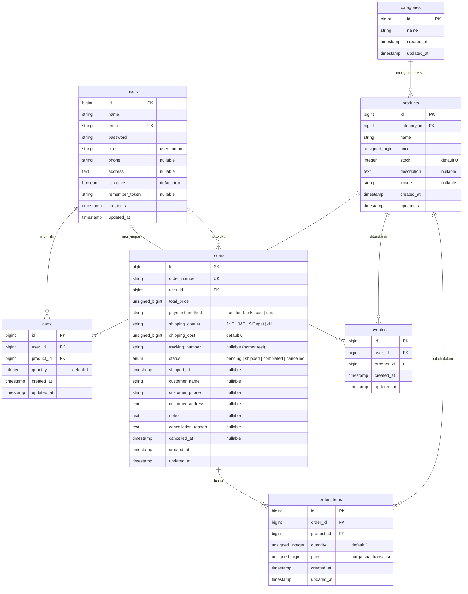

# 🏛️ Juragan Batik — Surakarta Est. 1928

[](https://laravel.com)
[](https://php.net)
[](https://www.postgresql.org/)
[](https://tailwindcss.com/)
[](#lisensi)

> **Platform E-Commerce & Kurasi Batik Warisan Surakarta**  
> Menghubungkan pecinta wastra nusantara dengan mahakarya batik tulis dan cap autentik langsung dari sentra pengrajin Solo dan Yogyakarta.

---

## 📌 Daftar Isi

1. [Tentang Proyek](#-tentang-proyek)
2. [Teknologi yang Digunakan](#-teknologi-yang-digunakan)
3. [Fitur Utama Sistem](#-fitur-utama-sistem)
   - [Halaman Publik & Pelanggan](#1-halaman-publik--tamu)
   - [Fitur Pengguna Terdaftar](#2-fitur-pengguna-terdaftar-member)
   - [Panel Kurator & Administrator](#3-portal-administrasi--kurator)
4. [Diagram Relasi Entitas (ERD)](#-entity-relationship-diagram-erd)
5. [Struktur Database & Relasi Model](#-struktur-database--relasi-tabel)
6. [Struktur Direktori Proyek](#-struktur-direktori-proyek)
7. [Daftar Rute & Endpoint](#-daftar-rute-dan-endpoint)
8. [Panduan Instalasi & Menjalankan](#-panduan-instalasi--menjalankan)
9. [Konfigurasi Environment (.env)](#-konfigurasi-environment-env)
10. [Integrasi WhatsApp API](#-integrasi-whatsapp-order)
11. [Lisensi & Hak Cipta](#-lisensi--hak-cipta)

---

## 📖 Tentang Proyek

**Juragan Batik** adalah aplikasi web e-commerce bernuansa budaya luhur yang dirancang khusus untuk memamerkan dan menjual koleksi kain batik eksklusif. Platform ini mengutamakan estetika visual Jawa klasik kontemporer dengan performa responsif, alur pemesanan langsung melalui WhatsApp untuk konsultasi personal, serta dashboard administrasi menyeluruh yang mencakup inventaris produk, pesanan, rekap keuangan, hingga pengelolaan akun pengguna.

---

## 💻 Teknologi yang Digunakan

| Sektor | Teknologi / Pustaka | Deskripsi & Catatan |
|---|---|---|
| **Framework Backend** | **Laravel 13** | Arsitektur MVC, Eloquent ORM, middleware, authentication session |
| **Runtime Bahasa** | **PHP 8.3 / 8.4** | Menggunakan fitur PHP 8 (Constructor Promotion, Strict Types, Enums) |
| **Basis Data** | **PostgreSQL** *(Didukung MySQL & SQLite)* | Database relasional dengan integritas data foreign key & cascade |
| **Styling & Desain** | **Tailwind CSS (CDN)** | Desain modern berdesain responsif dengan kustom palet warna Material You |
| **Tipografi & Ikon** | **Google Fonts & Material Symbols** | *Playfair Display* (klasik mewah) & *Plus Jakarta Sans* (keterbacaan optimal) |
| **Pemesanan Eksternal** | **WhatsApp Click-to-Chat API** | Format teks otomatis dinamis berisi detail pesanan dan data pemesan |
| **Ekspor Data** | **CSV / Excel Stream Export** | Ekspor rekap omzet & laporan penjualan tanpa dependensi berat pihak ketiga |

---

## ✨ Fitur Utama Sistem

### 1. Halaman Publik & Tamu
- **Beranda (Home)**:
  - Hero slider otomatis (durasi 5 detik) dengan sinkronisasi progress bar visual dan efek hover pause.
  - Kurasi Mahakarya Wastra (koleksi produk aktif dengan stok tersedia, otomatis menyembunyikan produk berstatus habis).
  - Segel Keaslian Wastra (Garansi Pewarnaan Alami, Sertifikasi Canting Halus, Bahan Sutra & Katun Primissima).
  - Tampilan sepenuhnya responsif untuk smartphone, tablet, laptop, dan monitor desktop.
- **Katalog Batik**:
  - Pencarian real-time berdasarkan kata kunci nama produk atau deskripsi motif.
  - Filter kategori dinamis dilengkapi fitur pencarian kategori pada dropdown.
  - Filter rentang harga (*dual range slider*) interaktif.
  - Pengurutan (*Sorting*): Otomatis memprioritaskan stok tersedia di atas dan memindahkan barang habis ke posisi paling bawah.
  - Indikator produk "Habis" yang konsisten baik untuk pengunjung tamu maupun pengguna terdaftar.
- **Detail Produk**:
  - Tampilan visual produk terpusat dengan tata letak proporsional dan bersih.
  - Penjelasan filosofi motif, spesifikasi ukuran, material, dan ketersediaan stok.
  - Tombol pembelian instan yang langsung terhubung ke WhatsApp kurator.
- **Cerita Kami (About)**:
  - Dokumentasi narasi sejarah, visi, serta nilai luhur pelestarian batik Surakarta sejak 1928.

### 2. Fitur Pengguna Terdaftar (Member)
- **Autentikasi Aman**: Registrasi akun baru, login session-based, dan logout.
- **Keranjang Belanja (Cart)**:
  - Tambah produk ke keranjang, perbarui kuantiti, serta hapus item.
  - Kalkulasi subtotal otomatis.
  - Tombol Checkout multi-produk langsung menyusun template pesanan ke WhatsApp resmi.
- **Koleksi Favorit (Wishlist)**:
  - Simpan dan hapus produk favorit hanya dengan 1 kali klik ikon hati.
- **Profil Pengguna**:
  - Kelola nama lengkap, email, nomor telepon (WhatsApp), dan alamat pengiriman default.
  - Ganti kata sandi dengan validasi keamanan ketat.
- **Pesanan Saya (`/pesanan`)**:
  - Lacak riwayat pemesanan yang dibuatkan admin/sistem.
  - Cek nomor resi pengiriman, kurir, dan rincian produk yang dibeli.
  - Tombol konfirmasi penerimaan barang untuk menyelesaikan pesanan (*Complete Order*).

### 3. Portal Administrasi & Kurator
- **Manajemen Produk (`/admin/products`)**:
  - Tambah, ubah, dan hapus katalog produk batik.
  - Upload foto produk, penyesuaian kategori, deskripsi, harga, dan manajemen stok.
  - Filter pencarian dan sorting cepat.
- **Manajemen Kategori (`/admin/categories`)**:
  - Modal AJAX cepat untuk menambah atau menghapus kategori batik tanpa reload halaman.
- **Manajemen Pesanan (`/admin/orders`)**:
  - Buat pesanan baru (`/admin/orders/create`) dengan fitur auto-fill data pelanggan dan kalkulasi biaya kirim otomatis.
  - Perbarui status pesanan: `pending` ➔ `shipped` (input resi) ➔ `completed`.
  - Fitur pembatalan pesanan berstatus `cancelled` disertai catatan alasan pembatalan.
  - Cetak atau hapus data pesanan.
- **Manajemen Pengguna (`/admin/users`)**:
  - Monitoring semua akun pengguna (Admin & Pelanggan).
  - Tambah akun admin baru langsung dari panel.
  - Fitur toggle status akun (Aktifkan / Nonaktifkan).
  - Reset kata sandi pengguna secara instan.
  - Hapus data akun baik satuan maupun massal (*bulk delete*).
- **Dashboard Keuangan & Rekap (`/admin/finance`)**:
  - Ringkasan metrik omzet kotor, total ongkir, pesanan berhasil, dan rata-rata nilai transaksi (AOV).
  - Analisis breakdown berdasarkan metode pembayaran dan pilihan jasa kurir (JNE, J&T, SiCepat, POS, dll).
  - Filter kustom rentang tanggal (*Date Range Filter*).
  - Ekspor laporan penjualan ke format Excel/CSV untuk pembukuan akuntansi.

---

## 🗄️ Entity Relationship Diagram (ERD)

Aplikasi dibangun di atas 7 tabel inti dengan integritas relasi relasional penuh:



---

## 🏛️ Struktur Database & Relasi Tabel

| Nama Tabel | Deskripsi & Fungsi | Relasi Eloquent |
|---|---|---|
| `users` | Menyimpan kredensial otentikasi, peranan akses (`admin` atau `user`), status aktif, dan profil alamat | `hasMany(Cart)`, `hasMany(Favorite)`, `hasMany(Order)` |
| `categories` | Kelompok klasifikasi batik (misal: Batik Tulis, Batik Cap, Kain Sutra, Sarung) | `hasMany(Product)` |
| `products` | Katalog produk wastra, harga, deskripsi, gambar, dan ketersediaan stok | `belongsTo(Category)`, `hasMany(OrderItem)`, `hasMany(Cart)`, `hasMany(Favorite)` |
| `carts` | Keranjang belanja pengguna terdaftar dengan kunci unik gabungan `[user_id, product_id]` | `belongsTo(User)`, `belongsTo(Product)` |
| `favorites` | Daftar penandaan produk yang disukai pengguna (`[user_id, product_id]`) | `belongsTo(User)`, `belongsTo(Product)` |
| `orders` | Header transaksi pesanan, status alur logistik, biaya pengiriman, resi, dan catatan pembatalan | `belongsTo(User)`, `hasMany(OrderItem)` |
| `order_items` | Rincian setiap produk, kuantiti, dan snapshot harga yang tercatat dalam sebuah pesanan | `belongsTo(Order)`, `belongsTo(Product)` |

---

## 📁 Struktur Direktori Proyek

```
Juragan-Batik/
├── app/
│   ├── Http/
│   │   ├── Controllers/
│   │   │   ├── Admin/
│   │   │   │   ├── FinanceController.php     # Rekap analitik keuangan & ekspor CSV
│   │   │   │   └── OrderController.php       # Manajemen pesanan & status logistik
│   │   │   ├── User/
│   │   │   │   └── OrderController.php       # Riwayat belanja & konfirmasi barang diterima
│   │   │   ├── AuthController.php            # Login, register, logout
│   │   │   ├── CartController.php            # Keranjang & checkout WhatsApp
│   │   │   ├── CategoryController.php        # Operasi AJAX kategori produk
│   │   │   ├── FavoriteController.php        # Toggle wishlist produk
│   │   │   ├── PageController.php            # Beranda, katalog, detail, tentang kami
│   │   │   ├── ProductController.php         # Manajemen produk kurator
│   │   │   ├── ProfileController.php         # Pembaruan biodata & password pengguna
│   │   │   └── UserController.php            # Manajemen akun & hak akses admin
│   │   └── Middleware/                       # Middleware autentikasi & otorisasi is_admin
│   └── Models/
│       ├── Cart.php
│       ├── Category.php
│       ├── Favorite.php
│       ├── Order.php
│       ├── OrderItem.php
│       ├── Product.php
│       └── User.php
├── database/
│   ├── migrations/                           # Skema DDL tabel database
│   └── seeders/                              # Data awal sistem & pengujian
├── resources/
│   └── views/
│       ├── admin/                            # Antarmuka panel admin
│       │   ├── finance/index.blade.php       # Laporan keuangan
│       │   ├── orders/                       # Daftar & form buat pesanan
│       │   ├── products/index.blade.php      # Manajemen inventaris produk
│       │   └── users/index.blade.php         # Kelola akun pengguna
│       ├── auth/                             # Login & Register
│       ├── cart/index.blade.php              # Tampilan keranjang belanja
│       ├── favorites/index.blade.php         # Tampilan produk favorit
│       ├── layouts/app.blade.php             # Master layout (Navbar responsif & Footer)
│       ├── pages/                            # Halaman publik terstruktur rapi
│       │   ├── about.blade.php               # Cerita filosofi batik
│       │   ├── catalog.blade.php             # Katalog & filter pencarian
│       │   ├── detail.blade.php              # Detail produk ringkas & elegan
│       │   └── home.blade.php                # Beranda, slider & kurasi
│       ├── profile/show.blade.php            # Pengaturan profil pengguna
│       └── user/orders/index.blade.php       # Halaman riwayat pesanan member
├── routes/
│   ├── web.php                               # Definisi seluruh rute aplikasi
│   └── console.php
└── public/
    ├── images/                               # Aset logo dan ilustrasi
    └── storage/                              # Berkas upload gambar produk
```

---

## 🛣️ Daftar Rute dan Endpoint

### 1. Halaman Publik & Tamu
| HTTP Method | URI | Nama Rute | Controller Action | Keterangan |
|---|---|---|---|---|
| `GET` | `/` | `home` | `PageController@home` | Halaman beranda utama |
| `GET` | `/katalog` | `catalog` | `PageController@catalog` | Katalog produk (filter & sort) |
| `GET` | `/katalog/{id}` | `product.show` | `PageController@show` | Halaman detail produk |
| `GET` | `/cerita-kami` | `about` | `PageController@about` | Filosofi & sejarah brand |

### 2. Autentikasi
| HTTP Method | URI | Nama Rute | Middleware | Keterangan |
|---|---|---|---|---|
| `GET` | `/login` | `login` | `guest` | Form masuk akun |
| `POST` | `/login` | `login.post` | `guest` | Proses validasi login |
| `GET` | `/register` | `register` | `guest` | Form pendaftaran pengguna |
| `POST` | `/register` | `register.post` | `guest` | Proses pendaftaran akun |
| `POST` | `/logout` | `logout` | `auth` | Keluar dari sesi akun |

### 3. Pengguna Terdaftar (`auth`)
| HTTP Method | URI | Nama Rute | Keterangan |
|---|---|---|---|
| `GET` | `/profil` | `profile.show` | Halaman kelola profil |
| `PUT` | `/profil` | `profile.update` | Perbarui data nama, HP, alamat |
| `PUT` | `/profil/password` | `profile.password` | Perbarui kata sandi pengguna |
| `GET` | `/beli/{productId}` | `product.buy` | Direct checkout WhatsApp satuan |
| `GET` | `/keranjang` | `cart.index` | Tampilan keranjang belanja |
| `POST` | `/keranjang/{productId}` | `cart.store` | Tambah item ke keranjang |
| `PUT` | `/keranjang/{cartId}/update` | `cart.update` | Ubah kuantiti keranjang |
| `DELETE` | `/keranjang/{cartId}` | `cart.destroy` | Hapus item dari keranjang |
| `POST` | `/keranjang/checkout` | `cart.checkout` | Checkout keranjang via WhatsApp |
| `GET` | `/favorit` | `favorites.index` | Daftar produk favorit |
| `POST` | `/favorit/{productId}/toggle` | `favorites.toggle` | Tambah/hapus favorit |
| `GET` | `/pesanan` | `user.orders.index` | Riwayat pesanan & status pengiriman |
| `PATCH` | `/pesanan/{id}/terima` | `user.orders.complete` | Konfirmasi barang telah diterima |

### 4. Portal Admin (`auth`, `is_admin`)
| HTTP Method | URI | Nama Rute | Keterangan |
|---|---|---|---|
| `GET` | `/admin/products` | `admin.products.index` | Kelola katalog produk |
| `POST` | `/admin/products` | `admin.products.store` | Tambah produk baru |
| `PUT` | `/admin/products/{id}` | `admin.products.update` | Perbarui data produk |
| `DELETE` | `/admin/products/{id}` | `admin.products.destroy` | Hapus produk |
| `GET` | `/admin/categories` | `admin.categories.index` | Data kategori (JSON) |
| `POST` | `/admin/categories` | `admin.categories.store` | Tambah kategori baru |
| `DELETE` | `/admin/categories/{category}` | `admin.categories.destroy` | Hapus kategori |
| `GET` | `/admin/orders` | `admin.orders.index` | Daftar semua pesanan |
| `GET` | `/admin/orders/create` | `admin.orders.create` | Form pembuatan pesanan manual |
| `POST` | `/admin/orders` | `admin.orders.store` | Simpan pesanan baru |
| `PATCH` | `/admin/orders/{order}/status` | `admin.orders.update-status` | Update resi & status pesanan |
| `PATCH` | `/admin/orders/{order}/cancel` | `admin.orders.cancel` | Batalkan pesanan |
| `DELETE` | `/admin/orders/{order}` | `admin.orders.destroy` | Hapus pesanan |
| `GET` | `/admin/users` | `admin.users.index` | Daftar pengguna & kurator |
| `POST` | `/admin/users` | `admin.users.store` | Tambah akun admin baru |
| `PUT` | `/admin/users/{user}` | `admin.users.update` | Edit identitas pengguna |
| `PATCH` | `/admin/users/{user}/toggle` | `admin.users.toggle` | Toggle aktif/nonaktif akun |
| `PATCH` | `/admin/users/{user}/reset-password` | `admin.users.resetPassword` | Reset kata sandi pengguna |
| `DELETE` | `/admin/users/{user}` | `admin.users.destroy` | Hapus satu pengguna |
| `DELETE` | `/admin/users-bulk` | `admin.users.destroyMultiple` | Hapus banyak pengguna sekaligus |
| `GET` | `/admin/finance` | `admin.finance.index` | Ringkasan metrik & rekap penjualan |
| `GET` | `/admin/finance/export` | `admin.finance.export` | Ekspor rekap keuangan (CSV/Excel) |

---

## 🚀 Panduan Instalasi & Menjalankan

### Persyaratan Minimum
- **PHP** versi 8.3 atau 8.4 (ekstensi aktif: `pdo`, `pdo_pgsql` atau `pdo_mysql`, `mbstring`, `openssl`, `curl`)
- **Composer** versi 2.x
- **PostgreSQL** versi 14+ (atau **MySQL** 8+)

### Langkah-Langkah Pemasangan

1. **Clone Repositori**:
   ```bash
   git clone <URL_REPOSITORY_ANDA> juragan-batik
   cd juragan-batik
   ```

2. **Instalasi Dependensi PHP**:
   ```bash
   composer install
   ```

3. **Salin dan Sesuaikan Berkas Environment**:
   ```bash
   cp .env.example .env
   ```

4. **Generate Kunci Aplikasi**:
   ```bash
   php artisan key:generate
   ```

5. **Buat Tautan Simbolis Storage (untuk Foto Produk)**:
   ```bash
   php artisan storage:link
   ```

6. **Konfigurasi Database & Jalankan Migrasi**:
   Sesuaikan parameter database di file `.env`, lalu eksekusi:
   ```bash
   php artisan migrate
   ```

7. **Isi Data Awal (Opsional)**:
   ```bash
   php artisan db:seed
   ```

8. **Jalankan Server Lokal**:
   ```bash
   php artisan serve
   ```
   Aplikasi sekarang dapat diakses melalui peramban di: **`http://127.0.0.1:8000`**

---

## ⚙️ Konfigurasi Environment (`.env`)

Contoh konfigurasi standar untuk database PostgreSQL lokal:

```env
APP_NAME="Juragan Batik"
APP_ENV=local
APP_KEY=base64:...
APP_DEBUG=true
APP_TIMEZONE=Asia/Jakarta
APP_URL=http://127.0.0.1:8000

# Konfigurasi Database PostgreSQL
DB_CONNECTION=pgsql
DB_HOST=127.0.0.1
DB_PORT=5432
DB_DATABASE=toko_db
DB_USERNAME=postgres
DB_PASSWORD=rahasia

# Session & Cache
SESSION_DRIVER=database
CACHE_STORE=database

# Pengaturan File Storage
FILESYSTEM_DISK=public
```

> **Catatan Akun Administrator:**  
> Untuk membuat akun admin pertama kali, jalankan perintah `php artisan tinker`:
> ```php
> App\Models\User::create([
>     'name'      => 'Kurator Agung',
>     'email'     => 'admin@juraganbatik.com',
>     'password'  => bcrypt('password123'),
>     'role'      => 'admin',
>     'phone'     => '081382958012',
>     'is_active' => true,
> ]);
> ```

---

## 💬 Integrasi WhatsApp Order

Aplikasi menggunakan integrasi link langsung ke nomor WhatsApp resmi Juragan Batik:
- **Nomor Kontak Default**: `+62 813-8295-8012`
- **Mekanisme**:
  - Ketika pelanggan menekan tombol **"Pesan Sekarang"** atau melakukan checkout keranjang, sistem menyusun pesan teks tersandi URL (*URL encoded*).
  - Pesan otomatis memuat: Nama Pelanggan, No. HP, Alamat Pengiriman, serta Daftar Barang (Nama Kain, Kuantiti, dan Total Harga).
  - Kurator dapat langsung menerima dan memproses transaksi via WhatsApp tanpa perlu gateway pembayaran yang rumit.

---

## 📄 Lisensi & Hak Cipta

Seluruh kode sumber, desain visual, identitas grafis, dan narasi filosofi motif merupakan milik eksklusif **Juragan Batik Surakarta (Est. 1928)**.  
Dilarang mendistribusikan ulang atau menggunakan aset komersial tanpa izin tertulis dari pemilik hak cipta.
